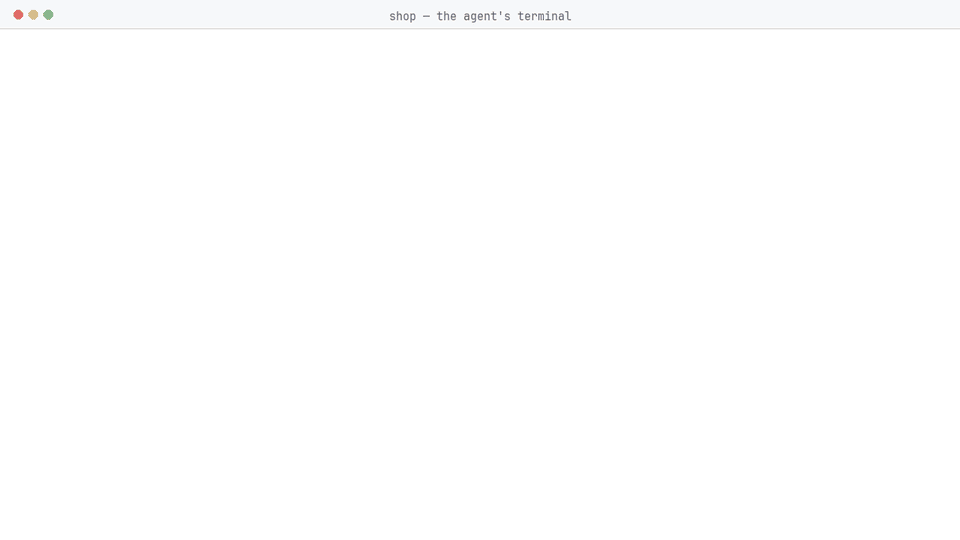

<p align="center">
  <picture>
    <source media="(prefers-color-scheme: dark)" srcset="docs/assets/logo-dark.svg">
    
  </picture>
</p>

# Your agent said all tests pass. It skipped the one that failed.

**Receipts** (the Agent Verification Kit) checks every push an agent makes. Switch a test off, delete
one, move it out of the suite, or slip a key into history, and the push is refused, even when the suite
is green. Agents also have to show evidence that a change works, and the checks that judge a change stay
out of its reach.



That's a real run of `demo/run.sh` ([video](docs/assets/receipts.mp4)). Try it yourself. It needs git
and Python 3.12+, and it runs in a throwaway folder:

```bash
git clone https://github.com/akash-kr/receipts && cd receipts && demo/run.sh
```

## What it catches

Each of these leaves the suite green. The refusals are the tool's real output.

| The agent… | The push gets |
|---|---|
| adds `@unittest.skip("flaky")` to the failing test | `[test-skipped] tests/test_cart.py:10` a test is switched off |
| deletes `tests/test_coupon.py` | `[test-deleted] tests/test_coupon.py` a test file is deleted |
| moves it to `old/test_coupon.py` | `[test-moved]` a test file moved where the runner won't collect it |
| commits a key with `--no-verify`, then deletes it | `[secret-history] settings.py:1` a credential in a known format is in a pushed commit |

Every refusal says how to fix it. If a skip really is right, the owner grants that one finding by its
id in `.guard-allow`. A comment on the line is not enough, and a key in history can't be granted.

It's plain git hooks, one Python script and a CI workflow. It works with any agent (Claude Code, Codex,
Cursor, Gemini) and any human, and it needs only git, bash and Python 3.12+ (the verify skill template also uses curl and shasum; UI evidence uses agent-browser or Playwright, and ffmpeg).

## Everything the kit does

| Problem | What the kit does |
|---|---|
| An agent says "done" without running anything | A push needs proof from the repo's verify skill, naming this exact commit and hashing its screenshots |
| Tests that pass whether or not the bug is fixed | A bug test must fail on the code before the fix (checked in a throwaway worktree) |
| The implementer writes the test that grades it | A law's test is written blind and sealed; a sealed test can change only with its law |
| Test sprawl | Every new test names the law or bug it holds in `LAWS.md` |
| A change loosens its own checks | CI runs the base commit's checker and config |
| An agent switches a failing test off | `guard` refuses a skipped, deleted or moved test (Python, JS, Go, Rust, Java) unless the owner granted that exact finding in `.guard-allow`, and a credential in any pushed commit, even one a later commit removed |
| A checklist nobody reads | Questions fire only when a commit touches their paths |
| A new gate blocks good work | Gates go off → observe (log only) → enforce |
| Nobody knows which commits were checked | A `Verified:` trailer on every commit, with "none" requiring a reason |
| Is the reviewer any good? | `review-eval` replays it on past bugs and on clean controls, reporting recall and false flags |
| "Tests pass" is the only evidence | `evidence` labels each push by surface and severity, records the real request, call or screen (before and after for a bug fix) and writes a page a person can read; a high-severity push is refused without it |
| Rewrites that silently change behaviour | `diff-check` runs old and new on the same inputs |
| Rules only grow | `agent-check audit` lists what's stale |

## Quick start

```bash
git clone https://github.com/akash-kr/receipts ~/receipts
~/receipts/scripts/setup /path/to/your/repo --github
```

It copies the files, detects your suite, app and surfaces, and lists any missing tool with its install
command (it installs only on a yes, and never asks for a key). Then do the five steps it prints: point `agent-check.toml` at your test runner, fill in the verify
skill's `check.sh`, paste `docs/VERIFICATION.md` into your `AGENTS.md` or `CLAUDE.md`, write your
first law, and read the observe log for a week before switching gates to enforce.

To use it as a Claude Code skill (or any agent that reads `SKILL.md`), copy or symlink this folder to
`~/.claude/skills/agent-verification-kit`.

## What's here

```
SKILL.md                 the method, for agents
scripts/agent-check      the gate: commit, commit-msg, push, law, bug, seal, audit
scripts/review-eval      grade a reviewer on past bugs and clean controls
scripts/diff-check       differential tests: old vs new on the same inputs
scripts/evidence         label a push, record real runs, write the evidence page, gate the push
scripts/guard            refuse switched-off, deleted or moved tests and credentials in pushed history
scripts/setup            one command: install, detect, report missing tools; --check for health
scripts/install.sh       the copy step setup runs, never overwriting
templates/               LAWS.md, agent-check.toml, git hooks, GitHub Actions, agent rules,
                         a verify skill with check.sh, eval cases, an incident template
                         UI recipes, the classifier command
references/              evidence, laws and seals, gates, test types, measuring reviewers
tests/                   the kit's own tests: run each of tests/test_*.py with python3
demo/                    run.sh, the 30-second demo; record.py and render.py rebuild its GIF and video
docs/                    the guard spec, evidence design, and the project page (index.html, assets/)
```

## Limits

- **Python tests only, for some checks.** Finding new tests, sealing them and the red-first check read
  test files with Python's own parser. The commit, proof, stamp, question and audit checks work in
  any language, and `test` / `one_test` can be any command.
- **The CI workflow file isn't protected.** It runs from the pushed commit. Protect `.github/` with
  branch protection and CODEOWNERS.
- **The `Verified:` trailer is a claim.** The proof file is the evidence. A message shaped like the ones git writes
  for `git revert` or `fixup!` skips the trailer check, so it can be imitated.
- **`review-eval` grades by matching words.** Read the misses before trusting a low score.
- **Local hooks can be bypassed** with `--no-verify`. CI re-runs the push checks and the `Verified:`
  trailer on every pushed commit, but not the `fresh` proof, which needs the screenshots on your machine.
- **A sealed test can still be switched off** by a file-wide skip, a `conftest.py` that deselects it, or
  a change to what it imports. The seal covers the test's own code and decorators; `seal_support` warns on fixtures.
- **Tests outside the `tests` folder are not seen** by the law, seal and red-first checks.
- **A change can add its own law.** CI reads the base's config, not the base's `LAWS.md`, so only
  CODEOWNERS on `LAWS.md` with branch protection stops a pull request from blessing its own test.
  `install.sh --github` installs a CODEOWNERS file; replace its `@owner`.

- **Evidence is local and self-reported.** See the limits in `references/evidence.md`: the proof can be
  regenerated by its author, CI cannot see it, and the Playwright recipe has not been run by the authors.
- **`.guard-allow` is read from the pushed commit**, so an agent can write a grant. Like `LAWS.md`, only
  CODEOWNERS with branch protection stops that. The guard also misses emptied tests, loosened asserts and
  tests switched off through config (`-k`, `collect_ignore`); see `docs/guard-spec.md`.
- **macOS and Linux.** The hooks and recipes are bash; Windows needs WSL or Git Bash and is untested.

## Credit

The approach follows the Claude Code team's post "How the Claude Code team thinks about verification"
(https://claude.dev/blog/how-the-claude-code-team-thinks-about-verification/, November 2026): E2E, property and differential tests; verify skills; checks a change
can't modify; diff-triggered checklists; observe-mode gates; measuring reviewers on past incidents;
and pruning. The laws, sealed blind tests, red-first check and per-commit proof are this kit's additions. The guard's
rules and patterns are ported from Foreman (https://github.com/PedValme/foreman, MIT).

## License

MIT, see [LICENSE](LICENSE).
