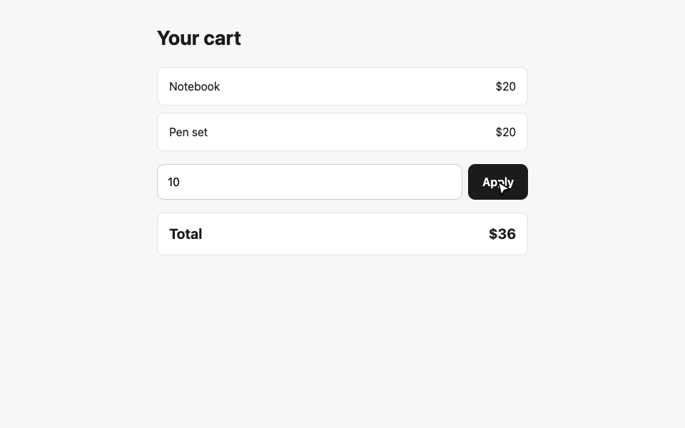
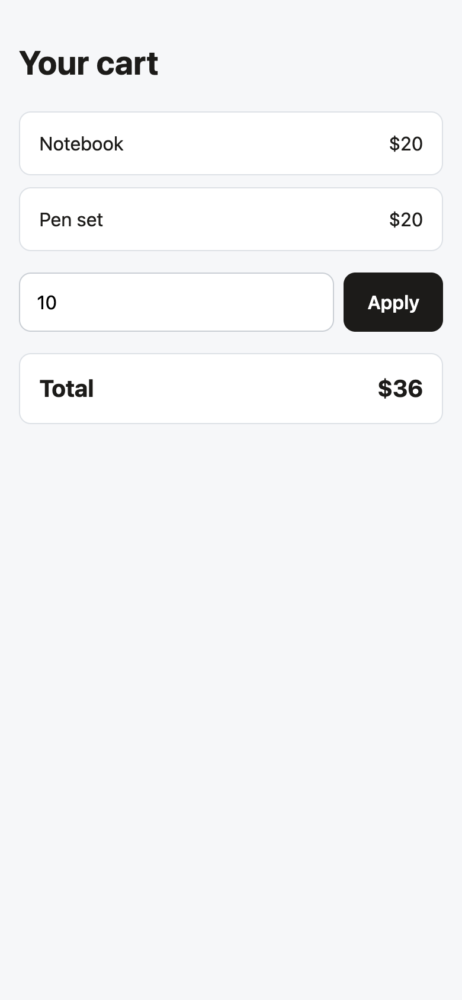

# Evidence: PASS

- Commit: `d24c9924bd` (change starts at `025bda6b0e`, 2 files)
- Surfaces: logic, ui. Intent: feature. Severity: low (labelled by rules).
- Recorded by: the author. Every result below was captured from a real run, not typed.

**Asked for:** Add a coupon box to the cart page.

## 1. the cart page has a coupon box — PASS

Surface: ui · environment: local

| | |
|---|---|
| Expected | status 200; output has `id="coupon"` |
| Before (old code) | does not: output lacks 'id="coupon"' (exit 0, status 200, 0.02s) |
| After (this commit) | meets it (exit 0, status 200, 0.02s) |

Ran:

```
curl -s -i "$EVIDENCE_URL/"
```

Got:

```
HTTP/1.0 200 OK
Server: BaseHTTP/0.6 Python/3.14.5
Date: Sun, 22 Nov 2026 10:23:41 GMT
Content-Type: text/html; charset=utf-8

<!doctype html>
<html lang="en"><head><meta charset="utf-8"><meta name="viewport" content="width=device-width, initial-scale=1"><title>Shop · Cart</title><link rel="icon" href="data:,">
<style>
body { margin: 0; font: 16px/1.5 system-ui, sans-serif; background: #f6f7f9; color: #1c1b19; }
main { max-width: 520px; margin: 0 auto; padding: 32px 16px; }
h1 { font-size: 28px; margin: 0 0 20px; }
.item, .sum { display: flex; justify-content: space-between; background: #fff; border: 1px solid #dde1e6; border-radius: 10px; padding: 14px 16px; margin-bottom: 10px; }
.coupon { display: flex; gap: 8px; margin: 18px 0; }
.coupon input { flex: 1; font: inherit; padding: 12px 14px; border: 1px solid #c9ced4; border-radius: 10px; }
.coupon button { font: 600 16px system-ui; padding: 0 20px; border: 0; border-radius: 10px; background: #1c1b19; color: #fff; }
.sum { font-weight: 700; font-size: 20px; }
</style></head>
<body><main>
<h1>Your cart</h1>
<div class="item"><span>Notebook</span><span>$20</span></div>
<div class="item"><span>Pen set</span><span>$20</span></div>
<form class="coupon" id="coupon-form"><input id="coupon" inputmode="numeric" placeholder="Coupon, e.g. 10 for 10%" aria-label="Coupon percent"><button>Apply</button></form>
<div class="sum"><span>Total</span><span id="total">…</span></div>
</main>
<script>
const show = (coupon) => fetch("/total?prices=20,20&coupon=" + (coupon || 0)).then(r => r.json()).then(d => { document.getElementById("total").textContent = "$" + d.total; });
document.getElementById("coupon-form").addEventListener("submit", (e) => { e.preventDefault(); show(document.getElementById("coupon").value); });
show(0);
</script>
</body></html>
```

On the old code it gave:

```
HTTP/1.0 200 OK
Server: BaseHTTP/0.6 Python/3.14.5
Date: Sun, 22 Nov 2026 10:23:41 GMT
Content-Type: text/html; charset=utf-8

<!doctype html>
<html lang="en"><head><meta charset="utf-8"><meta name="viewport" content="width=device-width, initial-scale=1"><title>Shop · Cart</title><link rel="icon" href="data:,">
<style>
body { margin: 0; font: 16px/1.5 system-ui, sans-serif; background: #f6f7f9; color: #1c1b19; }
main { max-width: 520px; margin: 0 auto; padding: 32px 16px; }
h1 { font-size: 28px; margin: 0 0 20px; }
.item, .sum { display: flex; justify-content: space-between; background: #fff; border: 1px solid #dde1e6; border-radius: 10px; padding: 14px 16px; margin-bottom: 10px; }
.sum { font-weight: 700; font-size: 20px; }
</style></head>
<body><main>
<h1>Your cart</h1>
<div class="item"><span>Notebook</span><span>$20</span></div>
<div class="item"><span>Pen set</span><span>$20</span></div>
<div class="sum"><span>Total</span><span id="total">…</span></div>
</main>
<script>
fetch("/total?prices=20,20").then(r => r.json()).then(d => { document.getElementById("total").textContent = "$" + d.total; });
</script>
</body></html>
```

## 2. apply a 10% coupon on the cart page: the total goes from $40 to $36 — PASS

Surface: ui

[Recording: flow.webm](media/flow.webm)


